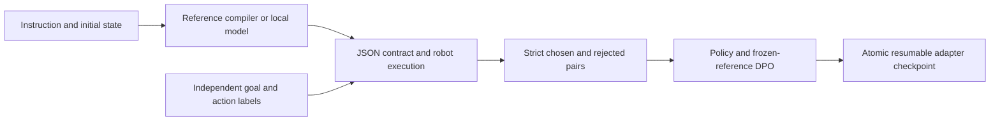

# Tool Calling Lab

<!-- at-a-glance -->
[](https://github.com/pavan139/tool-calling-lab/actions/workflows/ci.yml) 

| | |
| --- | --- |
| **Problem** | A tool call can parse and still be wrong: missing item, illegal route, dropped action. |
| **Result** | Execution-based scoring feeds LoRA SFT and DPO data; **40** tests, including bitwise-identical resume checks on tiny weights. |
| **Try it** | `pip install -e .` then `python -m tool_calling_lab evaluate --count 36 --output artifacts/reference.json` |
<!-- /at-a-glance -->


```text
Go 2 cells east. Pick up ruby.
          |
          v
move(direction="east", steps=2), pick(item="ruby")
```

Compiling the sentence is only the first check. The item must exist at the destination, the route must stay inside the grid, and a response must preserve the requested actions. This repository keeps those checks separate from model generation, then uses them to create supervised and preference-training data.

## Start with the robot

Python 3.11 or later is enough for the simulator and reference experiment:

```bash
python -m pip install -e . --no-build-isolation
python -m tool_calling_lab evaluate --count 36 --output artifacts/reference.json
python -m tool_calling_lab preferences --split train --count 12 --output artifacts/preferences.json
```

The first command scores a handwritten controlled-language compiler. Its 36/36 reference result checks the dataset and executor, not learned accuracy. A JSON-valid program can still fail execution; a program that ends in the correct position can still omit a required pickup. Reports retain all of those distinctions.

The robot has `move`, `pick`, and `drop` tools on a 7 by 7 grid. Responses allow at most eight calls and one to three cells per movement. The executor checks intermediate cells and returns a new state only after the whole program succeeds. It exposes no shell or filesystem tools.

## Train against an explicit contract

The optional `ml` extra provides completion-only LoRA SFT and a directly implemented DPO objective. Supply a local causal-model checkpoint:

```bash
python -m pip install -e '.[ml]'
python -m tool_calling_lab train --model /path/to/local-model --count 72 --steps 20 --output artifacts/sft
python -m tool_calling_lab dpo-train --model /path/to/local-model --initial-adapter artifacts/sft --count 36 --steps 20 --output artifacts/dpo
python -m tool_calling_lab dpo-evaluate --model /path/to/local-model --checkpoint artifacts/dpo --split validation --count 12 --output artifacts/validation.json
```

DPO pairs receive rewards from independent state labels and canonical action traces. The policy and frozen reference score completion tokens, including EOS, with prompt/padding tokens masked. Adapter, optimizer, RNG and data/configuration identities are committed together. Increasing the requested total steps can resume a run; changing its training data or objective settings cannot.

The controlled-language task families are held out by composition:

| Split | Move/pick/drop signatures |
| --- | --- |
| Train | `M`, `MP`, `MPMD` |
| Validation | `MMP`, `MPM` |
| Test | `MMPMD`, `MPMMD`, `MMPMMD` |

Phrases and item vocabularies also differ by split. The reference compiler knows all families. These partitions test specified compositions rather than unrestricted language understanding.



## Read the implementation

```text
src/tool_calling_lab/robot.py       Tool schemas, worlds and execution scoring
src/tool_calling_lab/preferences.py Execution-ranked pairs
src/tool_calling_lab/dpo.py         Objective, optimizer and checkpoints
recipes/                           Reference experiment settings
samples/                           Recorded outputs and tiny-model evidence
notes/                             Contracts, algorithms and run records
bin/dpo_smoke.py                    Bounded local optimizer experiment
tests/                             Parser, data, gradient and resume checks
```

[Preference optimization](notes/preference-optimization.md) gives the likelihood equations and checkpoint protocol. [Robot execution](notes/robot-execution.md) defines the action boundary. The longer [command reference](notes/command-reference.md) covers base/adapter comparison and token limits.

## Reproduce the recorded checks

```bash
python -m pip install -e . -r requirements-dev.txt
RUN_ML_SMOKE=1 PYTHONPATH=src python -m unittest discover -s tests -v
python bin/check_training.py --require-lint --wheel
```

The recorded suite has 40 tests. The opt-in checks create tiny random local weights, perform actual SFT/DPO updates, and verify bitwise-equivalent interrupted/resumed CPU optimization. The two-step DPO run's held-out execution result was 0/2; [its record](samples/dpo-integration-smoke.json) is kept unchanged. No pretrained adaptation gain or GPU performance result has been measured.

Use [checks and reproduction](notes/checks-and-reproduction.md) to interpret skipped versus executed tests, and [sharing checkpoints](notes/sharing-checkpoints.md) when preparing an archive or GitHub release.
