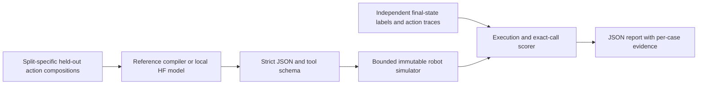

# Tool Calling Lab

A controlled experiment in compiling natural-language robot instructions into typed tool calls. The complete simulator, dataset generator, strict JSON validator, reference compiler, and evaluator use Python 3.11+ standard library only. Optional workflows perform **actual completion-only SFT and direct preference optimization (DPO) against a local Hugging Face checkpoint**, with executable preference labels and resumable optimizer state.

This is an intentionally synthetic personal research project. The default report measures a handwritten controlled-language reference, **not trained-model accuracy**. Tiny randomly initialized checkpoints have passed SFT and DPO train/save/load/evaluation integration experiments, including bitwise-equivalent interrupted/resumed CPU DPO optimization. No pretrained model quality or meaningful trained-model accuracy has been measured.



## Run the reference experiment

From this project directory:

```bash
python -m pip install -e .
python -m tool_calling_lab demo
python -m tool_calling_lab demo --output artifacts/demo.json
python -m tool_calling_lab evaluate --count 36 --output artifacts/reference.json
python -m tool_calling_lab dataset --split train --count 72 --output artifacts/train.json
python -m unittest discover -s tests -v
```

`demo`, `evaluate`, and `dataset` print JSON when `--output` is omitted. No network, credentials, external service, or model download is needed. `make test`, `make demo`, and `make evaluate` also work without installing by setting `PYTHONPATH=src`.

## Task and boundaries

The robot moves on a 7×7 grid. Tools are `move(direction, steps)`, `pick(item)`, and `drop(item)`. Calls are restricted to 8 per response; movement is limited to 1–3 cells per call. Every intermediate cell is checked. Unknown tools, extra keys, booleans masquerading as integer steps, duplicate JSON keys, out-of-bounds movement, and unavailable items fail explicitly. Execution cannot invoke shell commands or access files. Input state remains unchanged after failed execution.

The default **compositional suite** holds out action signatures as well as instruction templates and item vocabularies. Here `M`, `P`, and `D` mean move, pick, and drop:

| Split | Action compositions |
| --- | --- |
| Train | `M`, `MP`, `MPMD` |
| Validation | `MMP`, `MPM` |
| Test | `MMPMD`, `MPMMD`, `MMPMMD` |

Use `--suite primitive` for the original direction/distance/action-family sweep. Seeds include split and suite. Disjoint signatures test compositional transfer in a controlled language; they do **not** establish broad language generalization. The reference compiler explicitly supports all grammar families and remains a deterministic baseline.

Default evaluation uses 36 compositional test cases. Metrics separate JSON/schema validity, executability, exact tool-call match, final-state success, and **instruction success**. Final states are independently constructed labels, checked against golden execution before predictions are scored. Instruction success additionally compares canonical action traces, permitting split movement calls but preventing a skipped pick/drop sequence from earning credit merely because it ends in the same state. Every report records a dataset hash, action signatures, expected states, and raw outputs.

## Actual optional model workflow

Supply a **local causal-language-model checkpoint** compatible with Transformers and LoRA. No model identifier is automatically fetched. The optional dependencies are intentionally not installed by the default setup.

```bash
python -m pip install -e '.[ml]'
python -m tool_calling_lab hf-evaluate --model /absolute/path/to/base-model --count 36 --output artifacts/base.json
python -m tool_calling_lab train --model /absolute/path/to/base-model --count 72 --steps 20 --output artifacts/adapter
python -m tool_calling_lab hf-evaluate --model /absolute/path/to/base-model --adapter artifacts/adapter --count 36 --output artifacts/adapter-eval.json
```

The trainer uses completion-only labels, LoRA over linear layers, deterministic seeds, dynamic padding, and a 1024-token training-example limit. It saves an adapter, tokenizer, and training report. Inference is greedy and bounded by `--max-new-tokens` (default 256). Missing packages, invalid checkpoint paths, context overflow, or unsupported architectures raise errors; a fake model or silent reference fallback is never substituted. CPU works for sufficiently small models; practical memory requirements depend on the checkpoint. Default tests do not launch training. An explicitly enabled integration smoke trains a tiny randomly initialized model for one step.

Generation uses a fresh greedy configuration and disables inherited model defaults where supported, so checkpoint-specific forced tokens/minimum lengths cannot silently alter the experiment. Special output tokens remain visible to the strict JSON validator. Effective context uses the tightest real model/tokenizer limit; tokenizer vocabularies must fit model embeddings.

Compare base and adapter using the **same suite, test seed, count, tokenizer, generation budget, and hardware**. Select training settings on validation data before touching test results. Publish raw reports and training configuration; avoid reporting reference scores as learned-model results.

## Execution-derived preference optimization

The DPO pipeline is implemented directly, including completion-only sequence likelihoods, a frozen reference model, stable softplus loss, LoRA policy updates, and atomic adapter/optimizer/RNG checkpoints. Preference pairs are ranked by independently labeled execution and action semantics; there is no model-based reward judge.

```bash
# Fully local stdlib dataset generation; no ML dependencies or weights needed.
python -m tool_calling_lab preferences --split train --count 36 --output artifacts/preferences.json

# Actual optional DPO, starting from base weights or an existing SFT adapter.
python -m tool_calling_lab dpo-train --model /absolute/path/to/base-model --initial-adapter artifacts/adapter --output artifacts/dpo --count 36 --steps 20 --beta 0.1 --checkpoint-every 5

# Resume to a desired TOTAL step count. Keep data/model/optimizer settings unchanged.
python -m tool_calling_lab dpo-train --model /absolute/path/to/base-model --output artifacts/dpo --resume artifacts/dpo --count 36 --steps 40 --beta 0.1

# Validation first; use --split test only for a final held-out experiment.
python -m tool_calling_lab dpo-evaluate --model /absolute/path/to/base-model --checkpoint artifacts/dpo --split validation --count 12 --max-new-tokens 256 --output artifacts/dpo-validation.json
```

Omit `--initial-adapter` when starting DPO from base weights. An initial SFT adapter remains a frozen external reference dependency and its content hash must match on resume/evaluation. The DPO evaluator reports reference-adjusted preference accuracy and independently executed generated outputs separately. A preference improvement is not an execution-success claim.

Each committed `step-NNNNNN` contains a policy adapter, tokenizer, hashed optimizer/RNG state, and configuration manifest. A changed training dataset, base checkpoint, tokenizer, reference adapter, beta, learning rate, or library version rejects resume. Increasing total steps or changing checkpoint frequency is permitted. The implementation uses two base-model copies; memory requirements scale accordingly.

A reproducible bounded experiment creates random local weights and needs no downloads:

```bash
python bin/dpo_smoke.py --output artifacts/dpo-smoke.json
RUN_ML_SMOKE=1 PYTHONPATH=src python -m unittest discover -s tests -v
```

See [DPO algorithm and checkpoint design](preference-optimization.md), [recorded optimizer experiment](dpo-training-record.md), and `samples/dpo-integration-smoke.json`. These random-model experiments verify optimization/integration, not useful learned capability.

See [architecture](robot-execution.md), [configuration](../recipes/reference.json), and [example tool output](../samples/tool_calls.json).

## Review and integration evidence

See [review findings and limitations](contract-findings.md). `samples/reference-evaluation.json` is an executed deterministic reference evaluation; `samples/integration-smoke.json` records a random-checkpoint integration run, not model-quality evidence.

To reproduce the bounded optional integration test after installing the `ml` extra:

```bash
RUN_ML_SMOKE=1 PYTHONPATH=src python -m unittest discover -s tests -v
```

It creates a tiny local model and tokenizer in a temporary directory, performs one LoRA update on two examples, reloads the adapter, and verifies that generated special tokens are retained. No pretrained weights are downloaded.
