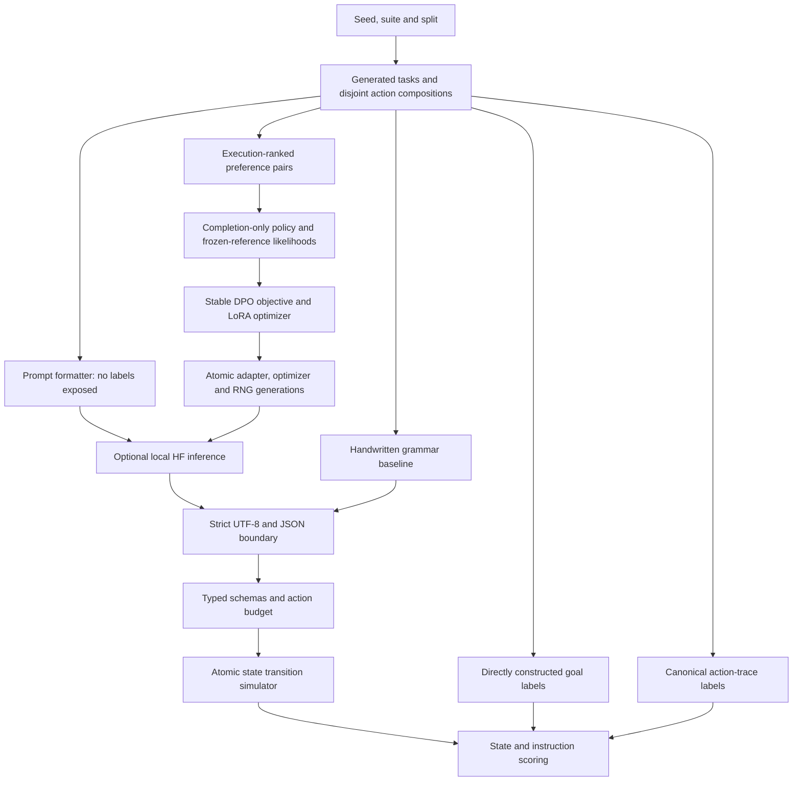

# Architecture and experiment contract

## Contracts and trust

Only task construction, labels and application code are trusted. Model text is limited to 16,384 UTF-8 bytes before parsing. Unicode encoding failures, huge JSON integers, invalid JSON, duplicate keys, extra fields, unknown tools and invalid argument types become explicit contract failures. Worlds are typed records, sizes are 1–64, obstacles are bounded tuples, and there are at most 128 named items. The action space exposes no shell, filesystem, dynamic code or network operations.

Execution validates every intermediate movement cell. State is immutable; all changes happen in local copies and only a new state is returned on success. Eight calls and three movement steps per call bound work.

## Independent evaluation labels

Both generators build expected tool calls and expected final-state labels directly from their sampled tasks. The scoring function verifies that golden execution matches the independent label; disagreement is a dataset/oracle error, not a model failure. It then scores raw predicted output against that label. Canonical traces expand movement into unit directions, retaining item events. This distinguishes equivalent movement partitioning from omitted required actions.

`execution_success` is final-state equivalence. `instruction_success` requires final-state equivalence plus canonical action semantics. Neither should be presented as free-form language competence. Duplicate case IDs are rejected and the exact dataset is hashed.

## Splits and generalization

The primitive suite sweeps direction, distance and action families. The default compositional suite uses disjoint action signatures across train, validation and test, plus split-specific phrases/items. It intentionally excludes obstacle planning and arbitrary dialogue. The handwritten compiler knows all split grammars; its perfect score verifies deterministic task coverage, not learned generalization.

## Training and generation

The optional HF module lazily imports dependencies and reads only local checkpoint directories. Training reads the train generator, masks prompt labels with -100, preserves completion/EOS labels, rejects context overflow without truncation, and saves an adapter plus a dataset-hashed report. The tightest positive model/tokenizer context limit applies; huge tokenizer sentinel limits are ignored. Tokenizer EOS and vocabulary are validated against model embeddings.

Inference is greedy and bounded. A fresh generation configuration plus `use_model_defaults=False` on Transformers versions that support it prevents inherited forced tokens/minimum lengths from overriding settings. Only a terminal EOS is removed; generated special-token text is retained for validation. There is no reference fallback on a model error.

## Verified scope

Core tests cover both suites, independent goal corruption, state aliasing, move partitioning, type/resource limits and malformed output. The opt-in integration test builds a tiny random GPT-2 checkpoint locally, trains one LoRA step, reloads it and checks raw-output handling. This verifies library integration only. Pretrained model quality, broad architecture support, GPU performance and useful adaptation remain unmeasured.

## Preference optimization branch

`preferences.py` constructs strict chosen/rejected pairs using independent execution rewards. Successful targets and schema-valid negatives stay within their split's action compositions. `dpo.py` computes completion-only sequence log probabilities and reference-adjusted DPO directly, rather than delegating the objective to a trainer wrapper. It commits content-bound optimizer/RNG generations atomically and resumes against exact data/model/configuration identities. Optional evaluation separates preference margins from actual task execution. See [preference-optimization.md](preference-optimization.md) for equations, state transitions and complexity.
